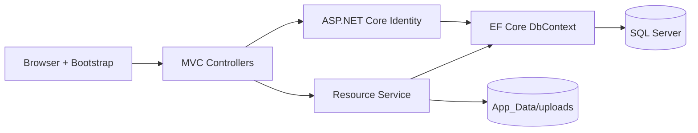
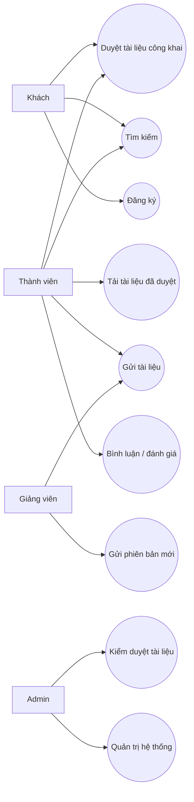
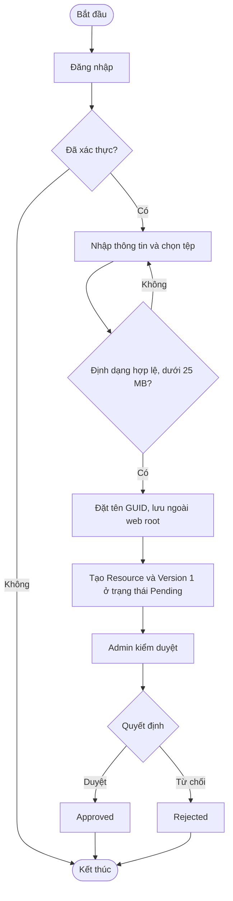
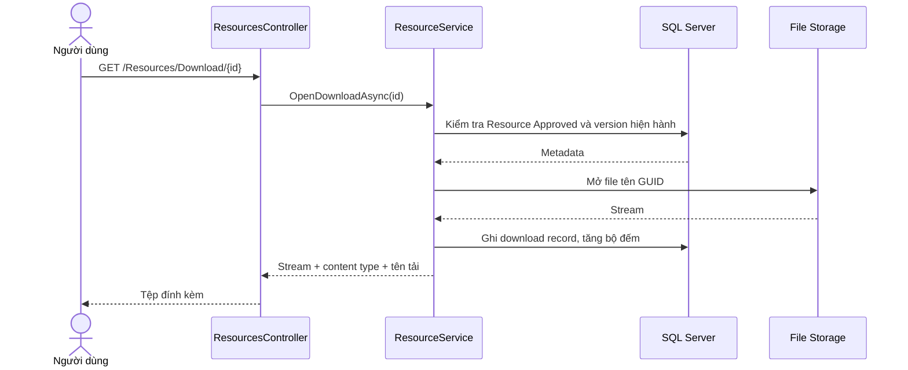

# Kiến trúc và luồng nghiệp vụ

Ứng dụng dùng kiến trúc phân lớp gọn trong một MVC project phù hợp nhóm hai sinh viên. Controller xử lý HTTP và kiểm tra quyền; `IResourceService` xử lý nghiệp vụ; `ApplicationDbContext` truy cập SQL Server; Identity quản lý tài khoản/vai trò; file vật lý lưu ngoài web root. DI được cấu hình trong `Program.cs`.

## Use case tổng quát

## Activity: gửi và duyệt tài liệu

## Sequence: tải xuống

## Ma trận quyền rút gọn

| Nghiệp vụ | Khách | Member | Lecturer | Admin |
|---|---:|---:|---:|---:|
| Xem/tìm tài liệu đã duyệt | Có | Có | Có | Có |
| Tải tài liệu đã duyệt | Có | Có | Có | Có |
| Gửi tài liệu, bình luận, đánh giá | Không | Có | Có | Có |
| Gửi phiên bản của tài liệu mình sở hữu | Không | Có | Có | Chưa có UI |
| Kiểm duyệt trạng thái | Không | Không | Không | Có |
| Quản lý người dùng/danh mục | Không | Không | Không | Chưa triển khai |

Kiểm tra quyền thực thi ở Controller bằng `[Authorize]` và `[Authorize(Roles=...)]`; ẩn liên kết UI không phải biện pháp bảo mật.
