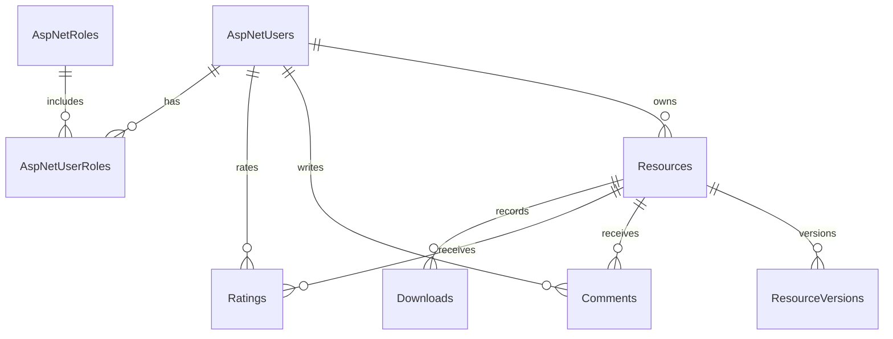

# Cơ sở dữ liệu

## ERD hiện triển khai

`AspNet*` là bảng ASP.NET Core Identity. Schema EF Core được quản lý bởi migrations.

| Bảng | Mục đích | Ràng buộc chính |
|---|---|---|
| Resources | Metadata, trạng thái và con trỏ file hiện tại | FK OwnerId; index Status/CreatedAt và Title |
| ResourceVersions | Lịch sử file bất biến | UNIQUE ResourceId + VersionNumber |
| Comments | Bình luận theo tài nguyên | FK ResourceId/UserId; giới hạn 2000 ký tự |
| Ratings | Đánh giá hiện hành | UNIQUE ResourceId + UserId; CHECK Score 1–5 |
| Downloads | Lượt tải theo phiên bản | Index ResourceId + CreatedAtUtc |
| ActivityLogs | Hành động và đối tượng tác động | Index CreatedAtUtc; không ghi thông tin xác thực |
| ResourceReports | Báo cáo nội dung | Index Resolved + CreatedAtUtc |

## Chuẩn hóa

Các thực thể lặp được tách thành bảng phiên bản, bình luận, đánh giá và lượt tải. Metadata file tách khỏi nội dung file lưu trên filesystem. Rating lưu một giá trị hiện hành duy nhất cho mỗi cặp tài nguyên/người dùng. Thiết kế phần đã có tuân theo hướng 3NF; danh mục môn học/tag chưa thêm do luồng sử dụng chưa triển khai.

## Migrations

`InitialCreate` và `AddAuditDownloadAndReports` là nguồn chuẩn tạo schema. Development tự chạy `Database.MigrateAsync()` và tạo role cơ bản. Production cần chạy `dotnet ef database update` trong release với connection string được bảo vệ.
